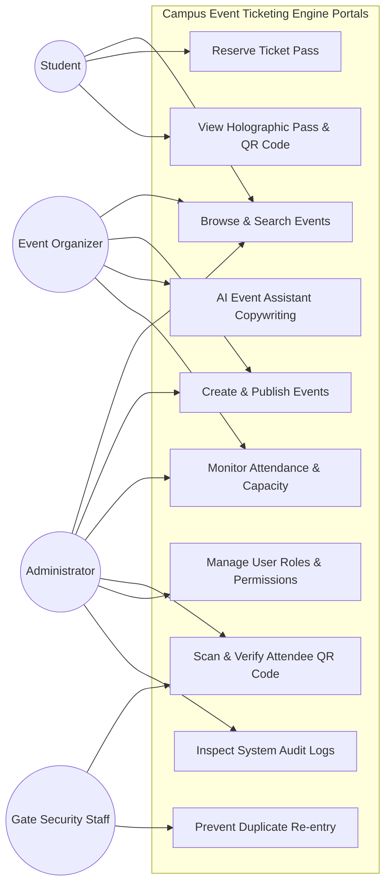
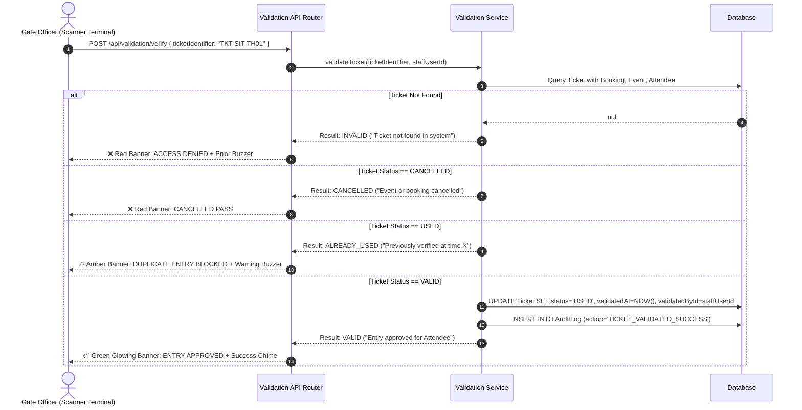
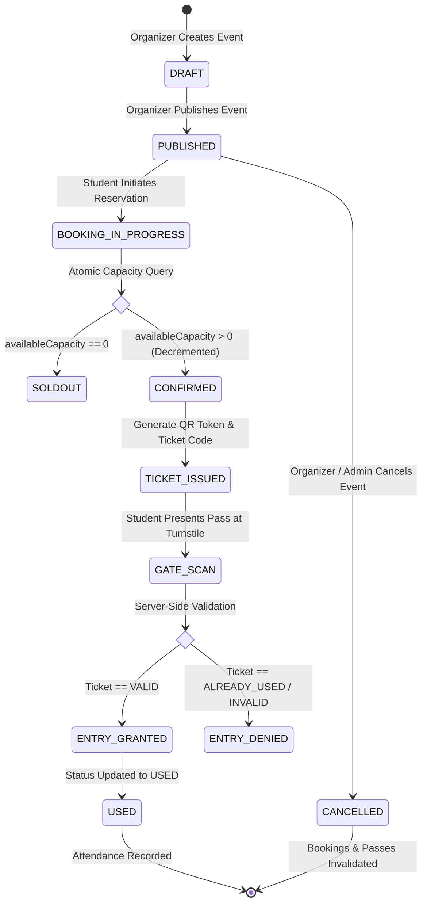
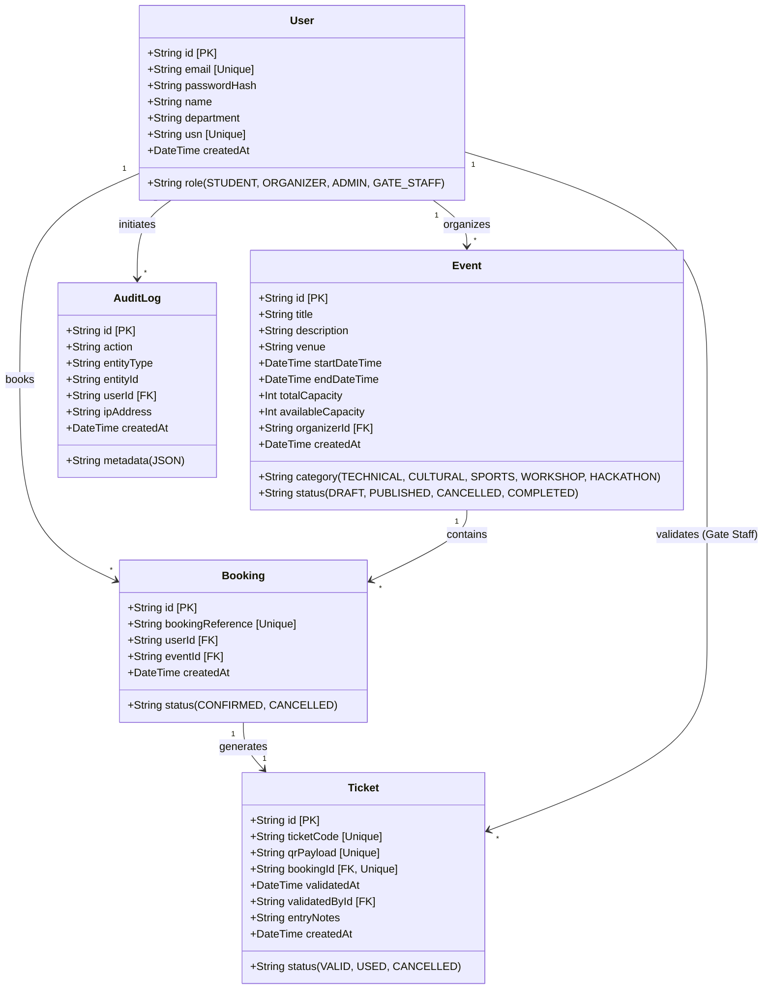

# Campus Event Ticketing Engine — System Architecture Document (SDS)

**Institution:** Siddaganga Institute of Technology, Tumakuru  
**Department:** Information Science & Engineering  
**Course:** Activity Based Learning – 1 (Software Project Management: Practical Approach using DevOps Tools)  
**Academic Year:** 2026–27  
**Project:** Campus Event Ticketing Engine  

---

## 1. Executive Architecture Summary

The **Campus Event Ticketing Engine** is an enterprise-grade, concurrency-safe web application designed to manage the complete lifecycle of campus events:

$$\text{Creation} \longrightarrow \text{Publication} \longrightarrow \text{Discovery} \longrightarrow \text{Registration} \longrightarrow \text{Capacity Verification} \longrightarrow \text{Booking} \longrightarrow \text{Digital Pass} \longrightarrow \text{Gate QR Validation} \longrightarrow \text{Audit Logging}$$

The application is structured as a **clean modular multi-tier architecture** with strict boundary separation between client-side presentation, API gateway & business logic, relational ACID storage, and automated DevOps delivery pipelines.

---

## 2. System Architecture Diagram

```mermaid
graph TB
    subgraph ClientLayer["Presentation Tier (Next.js 14 / TypeScript)"]
        Landing["Landing Page (3D Hologram Hero)"]
        Catalog["Event Discovery Catalog"]
        StudentPortal["Student Dashboard & My Passes"]
        PassView["Apple Wallet-Style Digital Pass (QR SVG)"]
        OrgStudio["Organizer Analytics Studio"]
        GateTerminal["Gate Security Turnstile Scanner"]
        AdminConsole["Admin Operations & Audit Console"]
    end

    subgraph ApiLayer["Application & Business Logic Tier (Node.js / Express / TypeScript)"]
        Router["Express REST API Router (/api)"]
        AuthMiddleware["JWT & RBAC Middleware (Role Guard)"]
        ZodValidator["Zod Input Validation Engine"]
        
        subgraph Services["Core Domain Services"]
            AuthService["Auth Service (Bcrypt + JWT)"]
            EventService["Event Lifecycle Service"]
            BookingEngine["Transactional Booking Engine (Atomic Decrement)"]
            ValidationService["Gate Turnstile Validation Service (Idempotent)"]
            AdminService["Audit Trail & User Management Service"]
        end
    end

    subgraph DataLayer["Persistence & Audit Tier (Prisma ORM)"]
        Prisma["Prisma ORM Client"]
        Database[("Relational Database (PostgreSQL / SQLite)")]
        Tables["Tables: User, Event, Booking, Ticket, AuditLog"]
    end

    subgraph DevOpsLayer["DevOps & Container Infrastructure"]
        Docker["Multi-stage Docker Containers"]
        Jenkins["Jenkins Declarative CI/CD Pipeline"]
        K8s["Kubernetes (Deployments, Services, ConfigMaps, Ingress)"]
    end

    ClientLayer -->|"HTTPS / JSON REST"| Router
    Router --> AuthMiddleware
    AuthMiddleware --> ZodValidator
    ZodValidator --> Services
    Services --> Prisma
    Prisma --> Database
    Database --- Tables
    DevOpsLayer -.->|"Orchestrates & Deploys"| ClientLayer
    DevOpsLayer -.->|"Orchestrates & Deploys"| ApiLayer
```

---

## 3. Use Case Modeling

The system implements four distinct security roles with server-side authorization:

---

## 4. Sequence Diagram: Atomic Concurrency-Safe Booking

The booking sequence prevents capacity overselling through atomic transactions and conditional updates:

```mermaid
sequenceDiagram
    autonumber
    actor Student as Student Client
    participant API as Express API Router
    participant Auth as RBAC Middleware
    participant Service as Booking Service
    participant DB as Relational DB (Prisma Transaction)

    Student->>API: POST /api/bookings { eventId } (Bearer Token)
    API->>Auth: Validate JWT & verify STUDENT role
    Auth-->>API: User Context Attached (userId, role)
    API->>Service: createBooking(userId, eventId)
    
    rect rgb(20, 30, 45)
        Note over Service,DB: BEGIN TRANSACTION (SERIALIZABLE / ACID)
        Service->>DB: Check existing booking: userId + eventId
        alt Already Booked
            DB-->>Service: Existing booking found
            Service-->>API: 409 Conflict: "Already reserved a ticket"
            API-->>Student: 409 Conflict Error
        end
        
        Service->>DB: UPDATE Event SET availableCapacity = availableCapacity - 1 WHERE id = :id AND availableCapacity > 0 AND status = 'PUBLISHED'
        alt availableCapacity == 0 (Capacity Exceeded)
            DB-->>Service: rowsUpdated = 0
            Service-->>DB: ROLLBACK TRANSACTION
            Service-->>API: 409 Conflict: "Event is completely booked"
            API-->>Student: 409 Conflict Error
        else Available Capacity Decremented
            DB-->>Service: rowsUpdated = 1
            Service->>DB: INSERT INTO Booking (bookingReference, userId, eventId, status='CONFIRMED')
            Service->>DB: INSERT INTO Ticket (ticketCode, qrPayload, bookingId, status='VALID')
            Service-->>DB: COMMIT TRANSACTION
        end
    end

    Service->>DB: INSERT INTO AuditLog (action='BOOKING_CREATE', userId, metadata)
    Service-->>API: 201 Created { booking, ticket }
    API-->>Student: JSON Confirmation + Ticket Pass Payload
```

---

## 5. Sequence Diagram: Gate Ticket Validation & Idempotent Turnstile Verification

---

## 6. Activity Diagram: Campus Event Lifecycle

---

## 7. Entity Relational Model (Class / Data Architecture)

